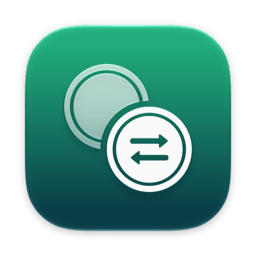
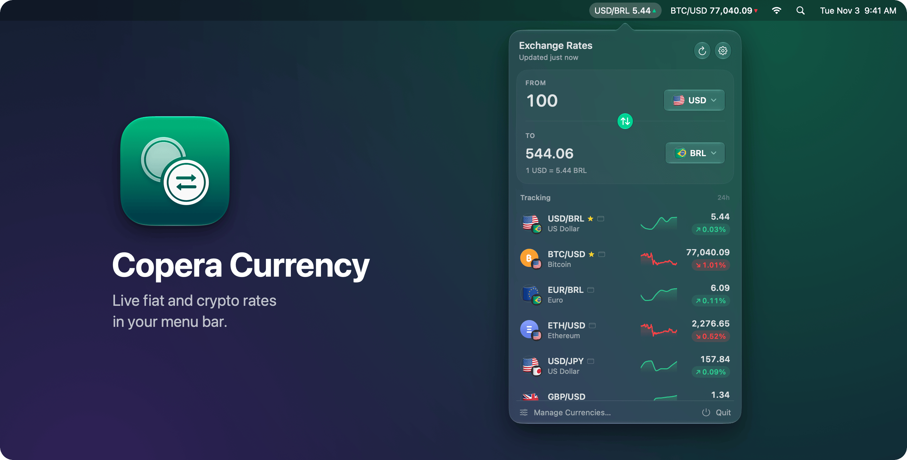
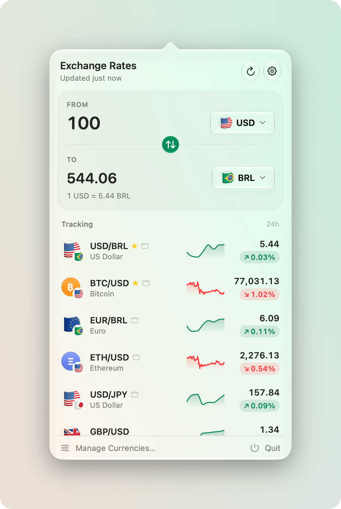
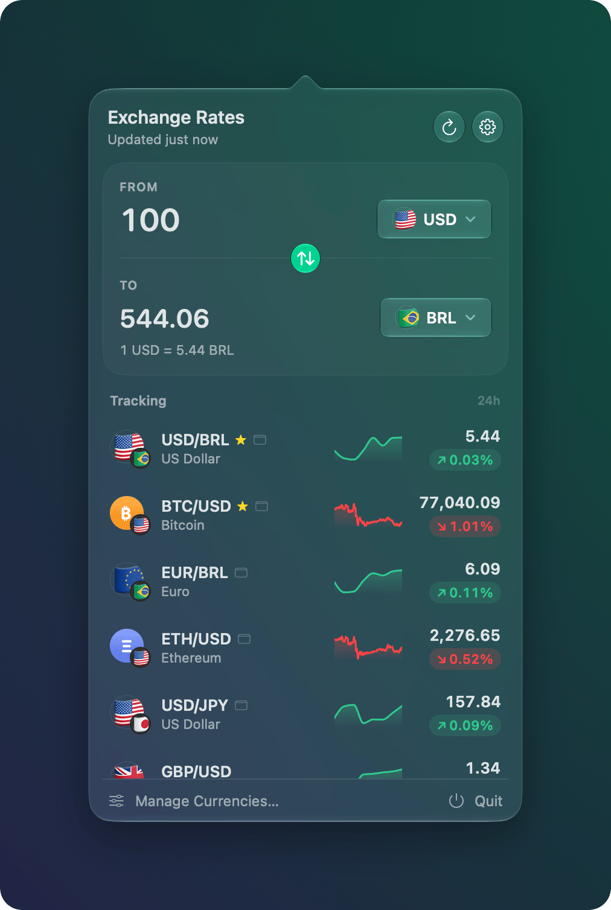
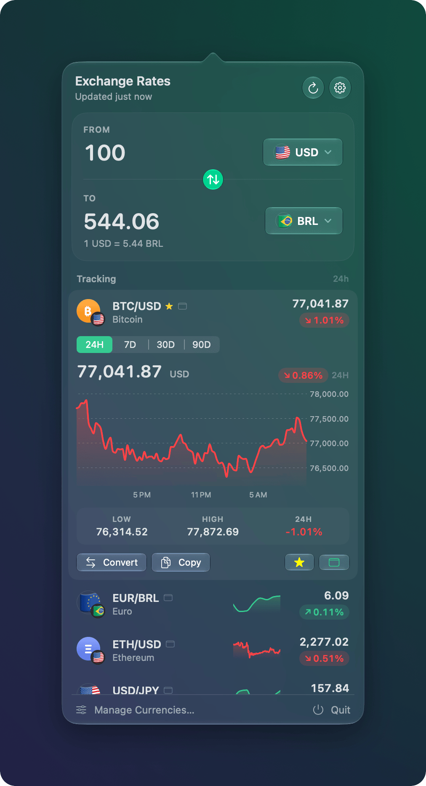
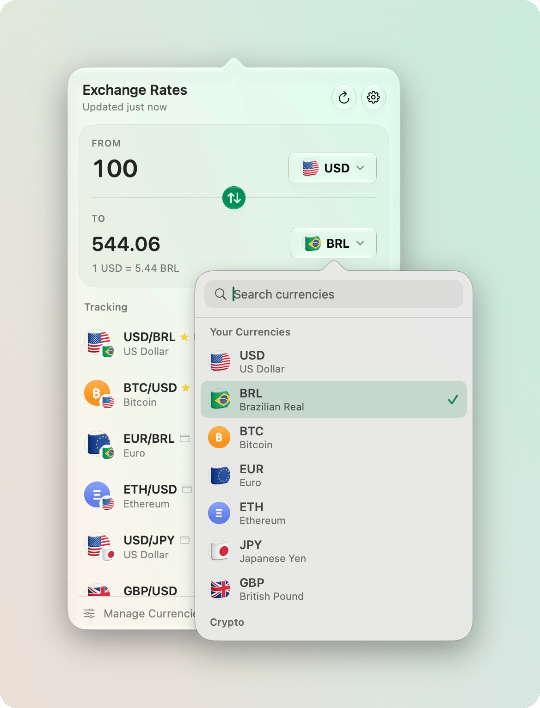
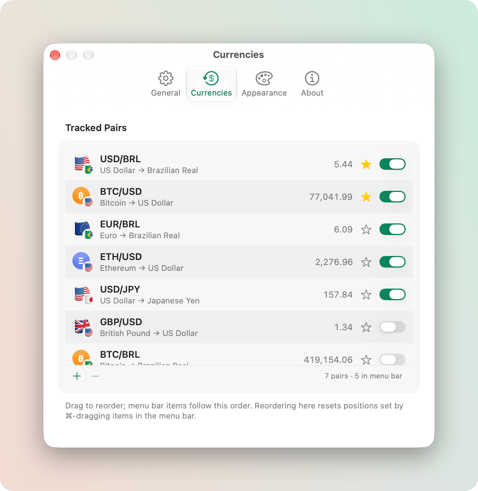
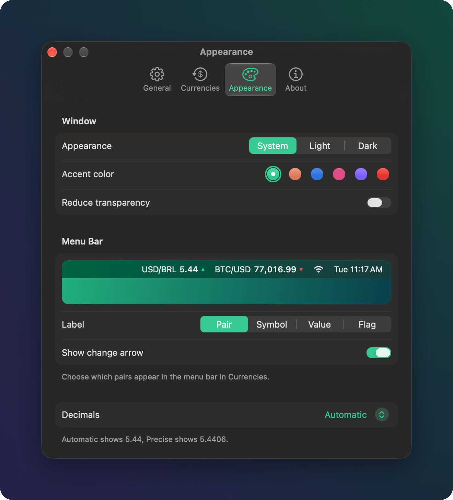

<div align="center">



# Copera Currency

**Live fiat and crypto rates in your Mac's menu bar, with a converter one click away.**

[](#requirements)
[](#requirements)
[](https://www.swift.org)
[](https://github.com/Copera-ai/currency/releases/latest)
[](LICENSE)



</div>

## See it in action

[](https://github.com/Copera-ai/currency/releases/download/v1.0.1/Copera-Currency-demo.mp4)

<sub>One-minute tour of the menu bar, converter, charts and settings. Click to play.</sub>

## Download

**[Download the latest release](https://github.com/Copera-ai/currency/releases/latest)**: open the `.dmg` and drag Copera Currency to Applications.

- Signed with a Developer ID and notarized by Apple, so it opens without Gatekeeper warnings.
- Updates itself through [Sparkle](https://sparkle-project.org). You can turn automatic checks off in Settings › General.
- It lives in the menu bar only, with no Dock icon. Click a rate to open the converter.

### Requirements

macOS 26 (Tahoe) or later on an Apple Silicon Mac (M1 or newer).

## Features

- **One menu bar item per pair.** Show `USD/BRL 5.44 ▲`, a symbol (`R$ 5.44`), a flag or just the value, with an optional up/down arrow. ⌘-drag items to reorder them.
- **Converter.** Type an amount (simple math such as `250*4` or `(12+8)/2` works), pick currencies from a searchable list, swap with one click and copy the result with ⌘C.
- **Real-time rates and change.** Fiat and crypto prices are live from Coinbase. Crypto shows Coinbase's 24-hour move; fiat shows the move since today's 00:00 UTC reference.
- **Sparklines and charts.** Every pair has a 24h sparkline. Expand a pair for a full chart with 24H, 7D, 30D and 90D ranges.
- **170+ currencies.** 150+ fiat currencies with flags, plus BTC, ETH, SOL, XRP, DOGE and other major crypto assets. Any pair works, including crypto to fiat (`BTC/BRL`).
- **Your pairs, your order.** Favorite pairs, drag to reorder, and choose which ones appear in the menu bar. Right-click a pair to copy its rate or load it into the converter.
- **Native Liquid Glass design.** Light, Dark or System appearance, six accent colors and a Reduce transparency option.
- **Stays current.** Refreshes every 15 seconds to 1 hour (30 seconds by default), when you open the popover, right after your Mac wakes and when the network comes back. The last rates stay visible offline, marked as stale.
- **Fits in.** Open at login, a global shortcut for the converter, and full keyboard navigation.

<table>
  <tr>
    <td width="50%"></td>
    <td width="50%"></td>
  </tr>
  <tr>
    <td align="center"><sub>Converter and tracked pairs (Light)</sub></td>
    <td align="center"><sub>The same popover in Dark mode</sub></td>
  </tr>
  <tr>
    <td></td>
    <td></td>
  </tr>
  <tr>
    <td align="center"><sub>Expanded pair with a 24H/7D/30D/90D chart</sub></td>
    <td align="center"><sub>Searchable currency picker</sub></td>
  </tr>
  <tr>
    <td></td>
    <td></td>
  </tr>
  <tr>
    <td align="center"><sub>Settings › Currencies: order, favorites, menu bar</sub></td>
    <td align="center"><sub>Settings › Appearance: theme, accent, label format</sub></td>
  </tr>
</table>

## Keyboard shortcuts

| Shortcut | Action |
| --- | --- |
| Your choice (Settings › General) | Open the converter from anywhere (unset by default) |
| ⌘C | Copy the converted amount (when no text is selected) |
| ⌘R | Refresh rates |
| ⌘, | Open Settings |
| ⌘Q | Quit |
| ↑ / ↓, then Return or Space | Move through pairs and expand or collapse a chart |
| Type, then ↑ / ↓ and Return | Search and pick in the currency picker |
| Esc | Close the picker or the popover |
| ⌘-drag a menu bar item | Reorder menu bar items |

## Data sources and privacy

| Data | Source |
| --- | --- |
| Live fiat rates, crypto prices, 24h crypto change and chart candles | [Coinbase](https://www.coinbase.com) public exchange-rate and market data |
| Fiat history, the daily reference for the fiat change, and fallback rates | [Fawaz Ahmed's currency-api](https://github.com/fawazahmed0/exchange-api) (daily snapshots, via Cloudflare Pages with a jsDelivr fallback) |

- **No accounts and no API keys.** Both sources are free and public.
- **No tracking or analytics.** The app only contacts the two rate sources above and, for updates, this repository's GitHub Releases.
- Your pairs and settings are stored locally in `~/Library/Application Support/ai.copera.currency`.
- Rates refresh every 15 seconds to 1 hour (30 seconds by default). Fiat change is measured against the 00:00 UTC daily reference. Rates are for information only, not for trading.

## Build from source

Requirements: macOS 26+, Apple Silicon, Xcode 26+ and

```sh
brew install xcodegen swiftlint
```

| Command | What it does |
| --- | --- |
| `make gen` | Generate `CoperaCurrency.xcodeproj` from `project.yml` (the project is not committed) |
| `make build` | Unsigned Debug build (arm64) into `build/DerivedData` |
| `make run` | `make build`, then open the app |
| `make test` | Run the `CurrencyKit` test suite (`swift test`) |
| `make lint` | `swiftlint lint --strict` |
| `make clean` | Remove `build/`, the generated project and the package build |

To work in Xcode, run `make gen`, open `CoperaCurrency.xcodeproj` and run the `CoperaCurrency` scheme. Run `make gen` again after adding or removing files.

Debug builds accept launch arguments that drive the UI for screenshots and QA, for example `-UITestOpenPopover YES -UITestAppearance dark`. See [`DebugLaunchHooks.swift`](CoperaCurrency/App/DebugLaunchHooks.swift).

## Project structure

```
CoperaCurrency/          The app (SwiftUI + AppKit)
  App/                   Entry point, AppDelegate, app model, window coordination
  MenuBar/               Status items and the shared popover
  Popover/               Converter, pairs list, sparklines and charts
  Settings/              General, Currencies, Appearance and About tabs
  Components/            Currency picker, badges, palette
  Updates/               Sparkle updater
Packages/CurrencyKit/    All logic and its tests: networking, rates engine, history,
                         formatting, persistence, refresh scheduling
Branding/                Icon sources, menu bar glyphs, DMG background
scripts/                 release.sh, publish.sh, sparkle-tools.sh
project.yml              XcodeGen spec
```

## Releasing

Releases are tagged `v<x.y.z>` and published as GitHub Releases. The build number is the commit count, so it always grows.

```sh
make release VERSION=1.1.0              # signed, notarized and stapled DMG + zip + checksums in build/release/dist
make publish VERSION=1.1.0 DRY_RUN=1    # preview the whole publish without building or uploading
make publish VERSION=1.1.0              # build, extend the Sparkle appcast, tag, push and create the release
```

Before publishing, add a `## 1.1.0` section to [`CHANGELOG.md`](CHANGELOG.md): it becomes both the GitHub Release notes and the Sparkle update notes. `make publish` runs on a clean `main` that matches `origin/main`.

One-time setup:

- A Developer ID signing identity for the team in [`scripts/release.sh`](scripts/release.sh) (`TEAM_ID`).
- A notarytool keychain profile named `apple-notary` (`xcrun notarytool store-credentials apple-notary ...`). Override it with `NOTARY_PROFILE`.
- The Sparkle EdDSA key in the login keychain under the account `copera-currency`. `make sparkle-key` prints the public key (`SUPublicEDKey`) and creates the key on first use.

See [`scripts/release.sh`](scripts/release.sh) and [`scripts/publish.sh`](scripts/publish.sh) for every step and environment variable.

## Acknowledgements

- [currency-api](https://github.com/fawazahmed0/exchange-api) by Fawaz Ahmed for free daily fiat history.
- [Coinbase](https://www.coinbase.com) for public crypto market data.
- [Sparkle](https://sparkle-project.org) for updates.
- [KeyboardShortcuts](https://github.com/sindresorhus/KeyboardShortcuts) by Sindre Sorhus.
- [XcodeGen](https://github.com/yonaskolb/XcodeGen) and [SwiftLint](https://github.com/realm/SwiftLint).

## License

[MIT](LICENSE) © Christian Curi
